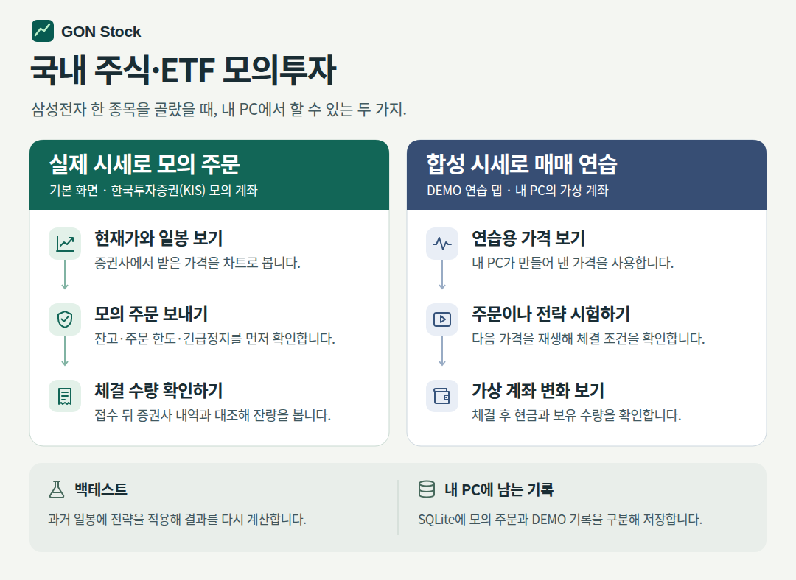

# GON Stock

개인 PC용 국내 주식·ETF 트레이딩 워크스페이스. 전체 화면과 설계 시각화에서 출발해 로컬 모의 기능과 KIS 모의 API를 단계적으로 연결합니다.

[1차 화면 함께 보기](docs/tasks/143-v1-guide.md)에서 화면을 고르면 버튼의 동작과 결과를 살펴보고 2차 수정 의견을 남길 수 있습니다.



[그림 확대](docs/architecture/figures/gon-stock-overview.svg) · [한 장 그림과 클릭형 구조도 내려받기 (HTML)](docs/architecture/figures/gon-stock03-overview.html?raw=1)

구조도 HTML을 브라우저에서 열고 구성요소를 누르면 해당 동작을 구현한 소스 코드를 확인할 수 있습니다.

- **대시보드:** http://127.0.0.1:4303/dashboard
- **상세 설계실:** http://127.0.0.1:4303/design
- **프로젝트 지도:** http://127.0.0.1:4303/project-map.html
- **KIS 모의 매매:** http://127.0.0.1:4303/paper

위 주소는 아래 명령으로 이 PC에서 실행했을 때 열립니다.

```bash
npm ci
npm run dev
```

Infisical CLI에 로그인하면 `npm run dev`가 `dev /kis`의 모의 계좌 설정 4개를 읽어 API 서버에 전달합니다. Node 24가 필요합니다. [실행·중지·복구 안내](docs/operations/local.md)를 참고하세요.

15개 화면에서 로컬 주문·취소·전략 재생·백테스트·한도·일지·관심목록을 사용합니다. KIS 모의 계좌에서 인증·잔고·현재가·일봉을 조회하고 수동 주문의 접수·체결과 응답 유실 후 복구를 확인했습니다. 연속 전략은 실제 신호에서 주문 전송이 차단되는 단계까지 관측했습니다. 실전 주문은 지원하지 않습니다. [장중 검증 기록](docs/verification/2026-11-18-live-transitions.md)

[초안 PR #4](https://github.com/krdn/gon-stock03/pull/4) · [현재 작업](docs/STATE.md) · [공식 조사](docs/research/kis-2026-11.md) · [시스템 설계](docs/architecture/workbench.md) · [검증 기록](docs/verification/2026-11-14.md) · [상위 이슈](https://github.com/krdn/gon-stock03/issues/1)

화면별로 이어서 개발하려면 [세션 계획과 전체 이슈 지도](docs/plans/interface-sessions-2026-11.md)를 먼저 확인하세요. [GitHub Project #25](https://github.com/users/krdn/projects/25)의 다음 세션 보기에서 Ready 작업 하나를 선택합니다. 첫 작업은 [기준선 확정 #5](https://github.com/krdn/gon-stock03/issues/5)입니다. 기존 기능은 보존하고 각 이슈의 남은 범위만 구현합니다.
