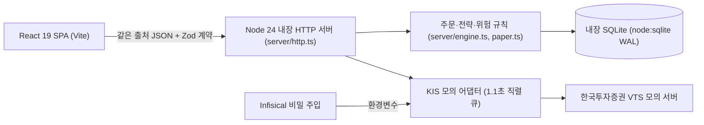

# 기술 스택 현황, 채택 근거 및 아키텍처 추천

> 요청: "이 프로젝트 프론트엔드, 백엔드, DB는 어떤 것을 사용하고 있는지, 왜 사용했는지, 판단해서 추천하는 것은?"
> 기준 문서: [트레이딩 워크스페이스 설계](workbench.md), [초기 조사 및 기술 결정](../start-context.json), [패키지 선언](../../package.json)

---

## 1. 현재 사용 중인 기술 스택

이 프로젝트(`gon-stock03`)는 **개인 PC용 국내 주식·ETF 모의 매매 워크스페이스**로, 단일 런타임(Node.js 24)과 로컬 파일 DB(SQLite) 위에서 동작한다.

| 영역 | 사용 기술 및 버전 | 핵심 역할 및 구현 특징 | 코드 근거 (`path:line`) |
| :--- | :--- | :--- | :--- |
| **프론트엔드** | **React 19.3 + TypeScript 7.0 + Vite 8.3** | • `react-router-dom` 7.18 기반 선언형 SPA 라우팅 (SSR 미사용) • 외부 UI 프레임워크(MUI 등) 없이 시맨틱 HTML 폼·테이블과 커스텀 CSS, `lucide-react` 아이콘으로 15개 화면 구성 | [`package.json:17-33`](../../package.json#L17-L33) [`src/App.tsx:1-35`](../../src/App.tsx#L1-L35) |
| **백엔드** | **Node.js 24 (`node:http`) + TypeScript (`tsx`)** | • 외부 웹 프레임워크(Express, Fastify 등) 없이 내장 `node:http` 모듈의 `createServer`로 REST API 및 정적 파일 서빙 직접 구현 • `127.0.0.1` 루프백 바인딩 및 `Host`·`Origin`·`x-workbench` 헤더 검사로 로컬 외 접근 차단 • **Infisical** CLI로 KIS 모의투자 비밀키를 프로세스 환경변수로 주입 | [`server/http.ts:1-49`](../../server/http.ts#L1-L49) [`server/kis.ts:23-35`](../../server/kis.ts#L23-L35) [`README.md:17`](../../README.md#L17) |
| **공통 계약** | **TypeScript + Zod 4.6** | • 프론트엔드(`src/`)와 백엔드(`server/`)가 `shared/` 디렉터리의 타입과 Zod 스키마를 직접 공유하여 런타임 경계 검증 수행 | [`shared/contracts.ts:1-35`](../../shared/contracts.ts#L1-L35) [`shared/model.ts:1-30`](../../shared/model.ts#L1-L30) |
| **데이터베이스** | **SQLite (`node:sqlite` 내장 `DatabaseSync`)** | • 외부 ORM이나 네이티브 애드온(`better-sqlite3` 등) 없이 Node.js 24 내장 `node:sqlite` 사용 • `WAL` 모드 및 `BEGIN IMMEDIATE` 트랜잭션으로 데모 상태(`workspace`), KIS 주문 원장(`paper_orders`), 종목 마스터(`market_instruments`), 일봉(`daily_bars`) 영속화 | [`server/store.ts:1-27`](../../server/store.ts#L1-L27) [`server/store.ts:35-51`](../../server/store.ts#L35-L51) |

---

## 2. 왜 이 기술들을 선택했는가? (채택 근거와 추론 사슬)

설계 문서([`docs/architecture/workbench.md:6-16`](workbench.md#L6-L16))와 초기 조사([`docs/start-context.json:66-76`](../start-context.json#L66-L76))에 기록된 사실(Fact)과 설계 결정(Decision)의 연결은 다음과 같다.

- **F1.1 (단일 사용자 로컬 범위)**: 제품의 운영 범위는 개인 PC, 단일 사용자, 국내 주식·ETF 모의 수동·전략 매매이며 다중 사용자·외부 네트워크 노출은 범위 밖이다 ([`docs/STATE.md:3`](../STATE.md#L3)).
  - *함의(Implication)*: 다중 사용자 인증 서버나 외부 독립 DB 서버를 별도로 띄우는 운영 비용은 불필요한 오버헤드다.
- **F1.2 (Node 24 내장 SQLite 지원)**: Node.js 24는 표준 라이브러리 `node:sqlite`의 `DatabaseSync` API를 통해 외부 C++ 네이티브 빌드 의존성 없이 파일 기반 ACID 트랜잭션을 지원한다 ([`docs/start-context.json:66-69`](../start-context.json#L66-L69), [`server/store.ts:1-15`](../../server/store.ts#L1-L15)).
  - *함의(Implication)*: 런타임 하나(Node 24)와 로컬 DB 파일 하나로 모든 상태와 주문 원장을 안전하게 보존할 수 있다.
- **F1.3 (단일 언어 계약 공유)**: 프론트엔드와 백엔드가 모두 TypeScript를 사용하면 별도의 OpenAPI 코드 생성 파이프라인 없이 `shared/contracts.ts`의 Zod 스키마를 양쪽에서 직접 참조할 수 있다 ([`docs/architecture/workbench.md:14`](workbench.md#L14)).
  - *함의(Implication)*: 화면과 API 사이의 데이터 계약 불일치를 컴파일 타임과 런타임 모두에서 최소 비용으로 차단할 수 있다.
- **F1.4 (KIS API 호출 간격 제약)**: 한국투자증권(KIS) 모의 API는 초당 호출 제한이 엄격하여 클라이언트에서 `1.1초` 간격의 직렬화 큐로 모든 인증·조회·주문을 제어해야 한다 ([`docs/architecture/workbench.md:57-59`](workbench.md#L57-L59), [`server/kis.ts:35`](../../server/kis.ts#L35)).
  - *함의(Implication)*: 대규모 병렬 DB 커넥션 풀보다 단일 프로세스 내 직렬 큐 제어와 전송 전후 주문 원장(`sending` → `accepted`/`unknown`)의 즉시 기록이 핵심이다.

| 결정 ID | 채택한 결정 | 근거 (Findings) | 기각한 대안 및 기각 사유 |
| :--- | :--- | :--- | :--- |
| **D1** | **Node 24 + 내장 `node:sqlite` 단일 런타임 채택** | F1.1, F1.2, F1.4 | **Rust(Axum) + PostgreSQL**: 다중 사용자·서버 확장에는 적합하나, 1인 로컬 PC 환경에서는 Rust 툴체인 및 별도 PostgreSQL 서비스 운영 부담이 과도함 ([`workbench.md:11-12`](workbench.md#L11-L12)) |
| **D2** | **TypeScript + Zod 직접 공유 (`shared/`)** | F1.3 | **Rust/OpenAPI 타입 생성**: 단일 TypeScript 저장소에서는 코드 생성 단계 없이 직접 import하는 편이 단순하고 검증 누락이 없음 ([`workbench.md:14`](workbench.md#L14)) |
| **D3** | **네이티브 HTML 폼·테이블 + 커스텀 CSS** | F1.1 | **MUI 등 대형 UI 라이브러리**: 15개 화면의 밀도 높은 테이블·주문 폼을 제어할 때 불필요한 번들 크기와 스타일 충돌을 유발함 ([`workbench.md:14`](workbench.md#L14)) |

---

## 3. 판단 및 추천 사항 (단계별 아키텍처 제안)

현재 선택된 **`React + Node 24(node:http) + 내장 SQLite(node:sqlite)`** 조합은 "개인 PC 1인 모의투자 워크스페이스"라는 현재 범위에 가장 부합하는 미니멀 아키텍처다. 따라서 현재 단계에서 프레임워크나 DB를 전면 교체하는 것은 권장하지 않으며, **운영 단계에 따라 다음 두 가지 트랙으로 진화**하는 것을 추천한다.

### 3.1 1단계 추천: 현재 로컬 워크스페이스 범위 유지 시 (현행 스택 유지 + 3가지 보강)

현재 기술 스택을 그대로 유지하되, 남은 이슈(#9, #11, #13, #14 등) 구현 과정에서 아래 3가지를 보강하는 것을 권장한다.

1. **SQLite JSON Blob 저장 구조 → 핵심 조회 컬럼 정규화 및 인덱스 분리**
   - **현황**: [`server/store.ts:11-15`](../../server/store.ts#L11-L15)에서 거의 모든 테이블이 `(id, body TEXT)` 형태로 JSON 문자열을 통째로 저장하고 전체 행을 읽어 `JSON.parse`로 처리한다.
   - **추천**: 종목 마스터(3,962종목)와 다년간의 일봉(`daily_bars`), 주문 원장(`paper_orders`)이 누적되면 전체 역직렬화 비용이 커진다. 자주 필터링·정렬하는 컬럼(`code`, `exchange`, `date`, `status`, `close`, `volume`)은 정식 SQLite 컬럼과 인덱스로 분리하거나 경량 타입 안전 쿼리 빌더(**Drizzle ORM**) 도입을 추천한다.
2. **백엔드 HTTP 라우팅 모듈화 (또는 초경량 `Hono` 도입)**
   - **현황**: [`server/http.ts:34-80`](../../server/http.ts#L34-L80) 단일 함수 내부에서 `if (path === ...)` 조건문으로 모든 엔드포인트를 분기한다.
   - **추천**: 엔드포인트가 늘어날수록 단일 파일 복잡도가 높아진다. 외부 의존성을 추가하지 않으려면 도메인별 라우트 핸들러 맵(`Record<string, Handler>`)으로 분리하고, 경량 라우터를 허용한다면 웹 표준 기반이고 Zod 통합이 뛰어난 **Hono**로 교체하는 것을 추천한다.
3. **KIS 실시간 WebSocket 연동 시 로컬 SSE(Server-Sent Events) 브릿지 활용**
   - **현황**: 브라우저는 주기적 REST 폴링(`GET /api/state`)으로 상태를 갱신한다 ([`src/App.tsx:21-30`](../../src/App.tsx#L21-L30)).
   - **추천**: 향후 KIS 실시간 체결/호가 WebSocket 연동(#14) 시, 백엔드가 KIS WebSocket 스트림을 수신하고 브라우저로는 `node:http` 기본 응답 스트림만으로 구현 가능한 **SSE(Server-Sent Events)**로 단방향 푸시하면 외부 WebSocket 서버 라이브러리 없이 실시간 화면 갱신이 가능하다.

---

### 3.2 2단계 추천: 운영 서버(`192.168.0.5`) 상시 배포 및 본격 자동매매 확장 시

개인 PC에서 브라우저를 열어두는 단계를 넘어, **홈 서버(`192.168.0.5`)에 Docker 컨테이너로 상시 배포**하거나 장중 무인 자동매매·대규모 백테스트를 수행할 때는 기술 결정을 재평가해야 한다([`workbench.md:14`](workbench.md#L14)).

| 전환 영역 | 현재 (1인 로컬 PC) | 확장 추천안 (서버 상시 운영·자동매매) | 전환 판단 기준 (Trigger) |
| :--- | :--- | :--- | :--- |
| **프로세스 구조** | 단일 Node 프로세스 (웹 서빙 + 전략/주문 통합) | **웹/API 서버**와 **장중 매매·수집 데몬(Worker)** 분리 (Docker Compose 구성) | 웹 UI 배포·재시작 시에도 장중 전략과 KIS WebSocket 세션이 끊기지 않아야 할 때 ([`server/store.ts:18-26`](../../server/store.ts#L18-L26)) |
| **운영 DB (OLTP)** | 내장 SQLite (`node:sqlite` 단일 파일) | **PostgreSQL (+ TimescaleDB)** (`192.168.0.5` 운영 DB 활용) | 웹 서버, 실시간 수집 데몬, 주문 실행기가 동시에 DB에 쓰기 작업을 수행하여 파일 락(`SQLITE_BUSY`) 한계를 넘을 때 |
| **분석/백테스트 DB (OLAP)** | 메모리 내 단순 배열 순회 ([`server/engine.ts`](../../server/engine.ts)) | **DuckDB** (Parquet/로컬 파일 기반 임베디드 컬럼형 엔진) | 전 종목(3,962개+) 수년 치 일봉·분봉을 대상으로 다중 팩터/포트폴리오 백테스트를 고속 연산해야 할 때 |
| **매매 코어 엔진** | TypeScript (`server/engine.ts`, `paper.ts`) | **Node.js Worker 유지** 또는 저지연 요구 시 **Rust (Axum/Tokio)** 분리 | 고빈도 틱 처리나 엄격한 메모리·지연 시간 보장이 필요해질 때 |
