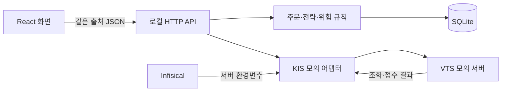

# 트레이딩 워크스페이스 설계

기준: [요구·조사](../research/kis-2026-11.md), [상위 이슈 #1](https://github.com/krdn/gon-stock03/issues/1). 사용자가 확정한 범위는 개인 PC, 국내 주식·ETF, 모의 수동·전략 매매다. 상세 시각화는 `/design`이며 [화면 레지스트리](../../src/specs.ts)가 화면별 계약을 소유한다.

## 기술 결정

`gon-web-engineering`을 적용했다. React/TypeScript strict, 의미 있는 HTML, 서버 검증, 비밀 분리, 오류·빈 상태, 브라우저·API·저장 검증을 유지한다.

| 후보 | 개인 PC 운영 | 계약·개발 | 결정 |
| --- | --- | --- | --- |
| React + Node 24 + SQLite | 하나의 런타임과 DB 파일. 외부 DB 서비스 불필요 | TypeScript 계약·Zod 경계 검증, 내장 SQLite 트랜잭션 | 채택 |
| React + Rust/Axum + PostgreSQL | Rust 도구와 DB 운영 필요 | 스킬 기본안, 서버형 다중 사용자 확장에 적합 | 이번 1인 로컬판에서는 조정 |

단일 PC·단일 프로세스 조건 때문에 첫 안을 택했다. SQLite는 전체 데모 상태를 트랜잭션으로 저장하고 KIS 주문 원장은 별도 테이블로 분리한다. 단순 SPA에 React Router 선언형 라우팅을 사용하며 SSR은 하지 않는다. 화면·서버가 같은 TypeScript 계약을 참조하므로 이번 버전은 Rust/OpenAPI 타입 생성 경로를 사용하지 않는다. 네이티브 폼·테이블로 필요한 UI를 구성하여 MUI 의존성은 추가하지 않았다. 다중 사용자·원격 서버·병렬 처리 요구가 생기면 기술 결정을 재평가한다.

공식 근거: [React](https://react.dev/learn/creating-a-react-app), [React Router](https://reactrouter.com/start/declarative/installation), [Vite](https://vite.dev/guide/), [Node SQLite](https://nodejs.org/api/sqlite.html), [Infisical](https://infisical.com/docs/cli/project-config). 실제 사용 버전은 package-lock.json에 고정했다.

## 책임과 데이터 흐름

| 위치 | 책임 |
| --- | --- |
| src/pages, src/components | 화면·폼·검토 대화상자·명시적 데이터 환경 표시 |
| shared/model.ts, contracts.ts | 응답 타입, 입력 검증, 원 단위·수량·종목코드 계약 |
| server/engine.ts | 데모 주문 예약·체결·취소·전략·비용·백테스트 |
| server/store.ts | SQLite 트랜잭션, 재시작 복구, KIS 주문 원장 |
| server/kis.ts | VTS 전용 인증·계약 변환·조회·주문 접수, 응답 비밀 제거 |
| server/paper.ts | KIS 사전조회·위험 검사·영구 원장·중복/불명 처리·대조 |
| server/http.ts, index.ts | loopback 바인딩·Origin/Host·요청 크기 검사·라우팅·데모 자동 재생 |

실제 KIS 잔고와 합성 데모 자산을 합산하지 않는다. KIS 계좌번호·키·토큰은 상태 API나 로그에 반환하지 않는다. 로컬 계정 자체의 악성 프로세스까지 막는 다중 사용자 인증 서비스는 아니다. 외부 포트 공개를 하지 않는다.

## 공통 상태 계약 (#6)

`GET /api/state`는 기존 DEMO 필드에 `instanceId`, `status`, `connection`을 추가한다. `shared/model.ts`의 `StateSnapshot`과 `shared/contracts.ts`의 Zod 검사를 서버·화면이 공유한다. 로컬 폴링 자체는 KIS를 호출하지 않는다. 기존 SQLite 형식과 금액 계산은 유지한다.

| 상태 | 의미 |
| --- | --- |
| disconnected / loading | 조회 전·미연결 / 조회 진행 중 |
| ready / stale | 전체 성공과 유효 관측 시각 / 신선도 기준 초과 또는 로컬 연결 유실 |
| partial / error | 유효 잔고 페이지를 관측했으나 전체 확정 실패 / 유효 페이지 없이 조회 실패 |

상태에는 `environment`, `source`, `observedAt`(최근 관측·실패 확인), `lastSuccessAt`(전체 성공), `complete`, `error`, `pages`가 있다. 신선도 기준은 로컬 10초, 잔고 60초, 현재가 3초다. 이는 앱 정책이며 거래소 지연·실제 마지막 거래 시각을 보장하지 않는다. 예를 들어 전체 잔고 성공 후 두 번째 페이지가 실패하면 이전 전체 성공 금액과 시각은 보존하고 `partial`, `complete=false`를 표시한다. 새 부분 금액이나 0원을 성공 잔고로 대체하지 않는다. KIS 상태는 서버 메모리에서 공유하며 재시작하면 미연결로 돌아간다.

전 화면은 DEMO·KIS 출처와 긴급정지 켜짐/꺼짐/미확인을 표시한다. 로컬 최신 상태를 확인하지 못하면 이미 열린 확인창을 포함해 새 작업을 차단한다. 새 서버 `instanceId`는 낮아진 revision도 새 상태로 받아들이고 폼·확인창을 초기화한다. 같은 서버의 새 요청에서 revision이 역행하면 연결 성공을 해제하고 새로고침을 안내한다. 겹친 요청의 늦은 응답은 최신 성공을 덮어쓰지 않는다. SQLite 파일을 실행 중 직접 교체하는 운영은 지원하지 않는다.

KIS 공통 클라이언트는 기존 1.1초 간격 직렬화를 모든 인증·조회·주문에 적용하고 대기 요청을 30개로 제한한다. 잔고 동시 조회는 한 작업을 공유한다. 최대 50페이지와 반복/누락 커서·중복 종목·페이지 간 합계 변화를 검사한다. 첫 페이지의 중복·연속 키 오류도 전체 확정 전이므로 부분실패다. 주문 사전검사는 진행 중인 화면 잔고 조회를 기다린 뒤 새 잔고를 조회한다. 현재가는 종목별 동시 요청과 3초 이내 조회를 재사용하며 주문 사전검사는 캐시를 우회한다. 토큰은 만료 60초 전에 갱신하고 발급 간격은 실제 전송부터 최소 60초다. 큐 포화로 미전송이면 발급 대기를 시작하지 않는다. GET 인증 만료만 최대 한 번 재인증 후 재조회한다. 갱신 대기 중이면 즉시 실패하고 기존 인증 거부 원인을 보존한다. 429·5xx·통신 실패와 주문 POST는 자동 재시도하지 않는다. 주문 POST의 HTTP401은 기존처럼 응답 불명으로 보존한다. 2xx의 KIS 명시적 업무 거부와 구분한다. 프로세스가 여러 개거나 다른 앱이 같은 키를 쓰는 경우의 계정 전체 호출량은 통제하지 않는다.

근거: 2026-11-15 확인한 [공식 잔고 샘플](https://github.com/koreainvestment/open-trading-api/blob/main/examples_llm/domestic_stock/inquire_balance/inquire_balance.py)의 연속조회 계약과 [인증 샘플](https://github.com/koreainvestment/open-trading-api/blob/main/examples_user/kis_auth.py)의 토큰 재사용·호출 간격. 공식 샘플의 모의 0.5초보다 보수적인 기존 1.1초를 유지했다. 계정별 실제 제한·장중 성능·실제 체결은 이번 가짜 응답 검사로 증명하지 않는다. [작업·검증 기록](../tasks/6-common-state.md).

## 주문과 복구

데모 주문은 입력 → 확인 → 서버 검사 → 미체결 예약 → 다음 봉 가격 조건 → 체결/취소 순서다. 매수 예약에는 비용을 포함하고 매도 예약에는 이미 예약한 수량을 포함한다. 같은 요청 ID는 한 주문으로 처리하며 내용이 다르면 거부한다. 데모는 전량 체결 모델이고 부분체결·호가 잔량·거래소 호가 단위·실제 세금은 재현하지 않는다.

KIS 주문은 계좌·당일 미체결·현재가·매수 가능수량을 다시 조회한다. 주문·종목 한도와 전송 직전 긴급정지를 검사한 후 `sending`을 영구 저장하고 VTS에 한 번 전송한다. 접수번호는 `accepted`이며 체결 확정이 아니다. 업무 거부는 `rejected`, 시간 초과/형식 불명은 `unknown`이다. `unknown` 또는 재시작 중 `sending`은 추가 주문을 차단한다. 증권사 번호가 있는 주문은 해당 거래일 내역으로 대조한다. 번호 없는 불명 주문은 자동 매칭·자동 해제하지 않으며 계좌 대조 후 복구 절차 구현이 남아 있다.

KIS 손실 한도 기준은 당일 첫 주문 사전조회의 KIS `tot_evlu_amt`(총평가금액)이다. 입출금 보정·실현손익·세금 기준 일손익은 아니다. 예수금 표시와 손실 기준을 분리하며 데모와 금액 한도는 공유한다. 한도 변경이 이미 전송 중인 증권사 요청을 취소하지 않는다. 미체결 정정·취소는 현재 KIS 모의 앱에서 처리하고 조회로 대조한다.

## 전략과 백테스트

전략은 단기/장기 이동평균의 교차에만 신호를 낸다. 한 봉을 한 번 평가하며 로컬 자동 재생은 3초마다 합성 봉을 생성한다. 전략 주문도 수동 주문과 같은 규칙으로 접수되며 다음 한 봉에서 미체결이면 만료된다. 전략은 수동 매수분을 포함한 계좌 보유수량을 사용한다. 긴급정지는 전략과 재생을 정지한다. 서버 재시작 후 자동 재개하지 않는다.

백테스트는 이전 봉까지의 신호를 다음 봉 가격에 실행한다. 예를 들어 5번 봉에서 상향 교차하면 6번 봉 가격에 슬리피지를 적용한다. 초기자금·수수료·슬리피지는 입력값이며 세금은 제외한다. 마지막 보유분은 평가하고 강제 청산하지 않는다. 현재 백테스트의 합성 표본은 기능 검증용이다. KIS 100일봉 조회 화면과 자동 연결하여 실제 성과인 것처럼 표시하지 않는다.

## 구현 경계

1차는 15개 화면·상세 설계실·공식 근거·클릭형 지도다. 2차는 로컬 기능과 KIS 조회/주문 접수 코드·원장까지 구현했다. KIS 주문 체결 실증, 웹 정정취소, 불명 주문 수동 해제, WebSocket 연속 자동매매와 장애 복구 실증은 남아 있다. [작업 #2](https://github.com/krdn/gon-stock03/issues/2)를 닫거나 제품 전체 완료로 선언하지 않는다.
