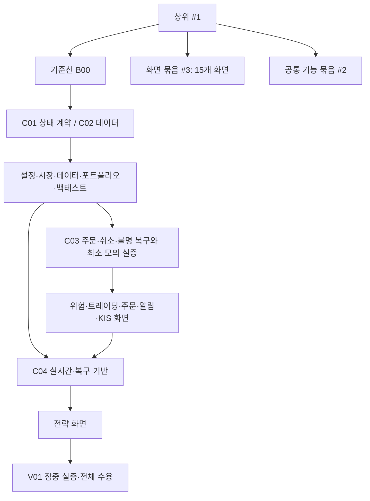

# 화면별 개발 세션 계획

요청: “대시보드와 설계실을 참고해서 인터페이스 모두를 GitHub에 저장하고, 하나하나 개발 세션에서 구현한다.” 분석 후 실제 등록까지 승인받았다(2026-11-15). 이번 작업은 계획·이슈·Project 구성이다. 새 제품 기능은 후속 세션에서 구현한다.

**결정: 15개 화면 이슈 + 공통 기능 4개 + 기준선 1개 + 장중 실증 1개로 관리한다.** 다음 세션은 [기준선 #5](https://github.com/krdn/gon-stock03/issues/5)다. 기존 [상위 #1](https://github.com/krdn/gon-stock03/issues/1), [화면 #3](https://github.com/krdn/gon-stock03/issues/3), [기능 #2](https://github.com/krdn/gon-stock03/issues/2), [Project #25](https://github.com/users/krdn/projects/25)를 재사용한다. 새 작업은 21개이며, 21번의 세션 완료나 작업시간을 보장하는 숫자가 아니다.

## 근거와 관리 방식

| 확인 사실 | 의미와 결정 |
| --- | --- |
| [화면 레지스트리](../../src/specs.ts)는 15개 화면의 목적·행동·데이터·실패·완료 조건을 정의한다. | 화면 하나마다 추적할 이슈를 둔다. 레지스트리는 현재 계약이다. 이슈는 다음 변경 목표다. 구현 PR에서 두 내용을 함께 갱신한다. |
| `/dashboard`는 합성 계좌·시세, `/design?tab=screens&screen=orders`는 목표 주문 생명주기를 표시한다. 2026-11-15 브라우저에서 확인했다. | 화면이 있다는 사실과 KIS 기능 완성을 구분한다. 기존 기능은 재구현하지 않는다. |
| [구현 경계](../architecture/workbench.md)는 주문·위험·저장·KIS 어댑터의 공유 책임을 정의한다. | 화면마다 서버 기능을 복제하지 않는다. 공통 기능은 독립 이슈 하나가 소유한다. |
| [PR #4](https://github.com/krdn/gon-stock03/pull/4)는 초안이며 기준 head는 `f81b51c8a8116608f3317b23e9a7f6893830a728`다. 해당 application/configuration CI는 성공했다. | 후속 구현 전에 기준선 통합 작업을 진행한다. CI 성공을 사용자 화면 수용으로 바꾸지 않는다. |
| [기존 검증](../verification/2026-11-14.md)은 로컬 23개·브라우저 9개와 KIS 실조회를 기록한다. | 이번 조사에서 모든 기능 테스트를 다시 수행한 것은 아니다. 실제 주문·체결·연속 운영 증거는 여전히 없다. |

관리안 비교는 이번 저장소에 대한 판단이다. 점수는 1(불리)~3(유리)이며 실험 측정값이 아니다.

| 후보 | 사용자 추적 | 중복 방지 | 세션 인수인계 | 합계 |
| --- | ---: | ---: | ---: | ---: |
| 화면 15개만 순서대로 구현 | 3 | 1 | 2 | 6 |
| 프론트·서버·DB 기술 계층별 구현 | 1 | 3 | 2 | 6 |
| 화면별 수용 이슈 + 공통 기능 의존성 | 3 | 3 | 3 | 9 |

세 번째 안은 사용자가 화면 기준으로 진행을 보면서 공통 주문·데이터 계약을 한 번만 구현하게 한다. 대신 관계를 관리해야 한다. 작은 보완은 기존 화면 이슈의 체크리스트로 끝낸다. 독립된 결과·검증·PR이 필요한 경우에만 새 하위 이슈로 나눈다.

GitHub는 [하위 이슈](https://docs.github.com/en/rest/issues/sub-issues)와 [차단 의존성](https://docs.github.com/en/rest/issues/issue-dependencies)을 지원한다. 본문 링크와 함께 실제 관계를 등록하고 재조회한다. [공식 Projects 지침](https://docs.github.com/en/issues/planning-and-tracking-with-projects/learning-about-projects/best-practices-for-projects)에 맞춰 작업·상태의 기준을 GitHub에 둔다.

## 이슈와 선후관계

화면 이슈의 완료 범위는 이슈에 명시한 UI·API 연결·실패 상태·회귀 검증과 그 변경의 사용자 수용이다. B00은 초기 화면 기준선, 화면 이슈는 해당 변경, V01은 장중 통합 흐름을 수용하므로 대상이 다르다. 사용자 검토를 순차로 기다리는 비용은 한 화면씩 협의한다는 요청에 맞춰 수용한다. 공통 서비스 구현과 중복하지 않는다. 최초 상태는 기존 구현을 포함한 **미완료 후속 작업**이며, 모든 화면을 새로 만드는 백로그가 아니다.

<!-- task-tables:start -->
### 공통·기준선·실증

| 이슈 | 현재 상태 | 남은 범위 | 선행 |
| --- | --- | --- | --- |
| [B00 #5 PR #4 검토·수용 범위와 후속 브랜치 기준 확정](https://github.com/krdn/gon-stock03/issues/5) | PR #4 초안 OPEN, f81b51c의 application/configuration CI 성공. 사용자 화면 수용 미확인. | 기존 구현을 후속 작업의 출발점으로 확정한다. 범위 제한을 유지한 기준선 PR을 검토하고, 사용자 화면 피드백과 required checks를 확인한 뒤 정상 PR 절차로 통합한다. 기능 전체 완료와 기준선 채택을 구분한다. | 없음 |
| [C01 #6 환경·출처·신선도·부분실패 상태 계약](https://github.com/krdn/gon-stock03/issues/6) | DEMO 공통 상태와 별도 KIS 응답이 존재한다. | 현재 구조를 유지하며 화면에 필요한 환경·출처·관측시각·최종 성공·오류·불완전 상태의 계약을 정한다. DEMO 자산과 KIS 모의 자산을 섞지 않는다. 공통 KIS 조회 경로가 잔고 연속 페이지·토큰 재사용·호출 제한·현재가 갱신 빈도를 소유한다. 전 화면 환경 표기와 긴급정지 배너도 이 작업이 소유한다. | [B00 #5](https://github.com/krdn/gon-stock03/issues/5) |
| [C02 #7 국내 종목 마스터·일봉 수집과 품질 검증](https://github.com/krdn/gon-stock03/issues/7) | 예시 종목·합성 120봉, paper에서 KIS 최근 100일봉 조회 가능. | 공식 계약을 다시 확인하고 국내 주식/ETF 마스터와 기간별 일봉을 중복 없이 저장한다. 요청 한도·페이지·누락·수정주가 정책을 명시한다. 장기 분봉은 제외한다. | [C01 #6](https://github.com/krdn/gon-stock03/issues/6) |
| [C03 #9 KIS 웹 취소·정정 계약과 불명 주문 복구](https://github.com/krdn/gon-stock03/issues/9) | 영구 주문 원장·ID 중복 방지·응답 불명 차단·REST 대조 코드 존재. 웹 취소/번호 없는 불명 복구 미구현. | VTS 지원 계약을 확인해 취소·필요한 정정 동작을 공통 서비스에 구현한다. 번호 없는 불명 주문은 근거를 대조한 명시적 복구 절차로만 해제한다. 자동 재전송은 금지한다. 화면 개발에 앞서 기존 승인 범위를 확인하고 장중 최소 모의 접수→REST 대조를 실증한다. 미체결 잔량이 있으면 취소를 확인한다. 조작 UI는 S15가 소유한다. | [C01 #6](https://github.com/krdn/gon-stock03/issues/6), [S13 #8](https://github.com/krdn/gon-stock03/issues/8) |
| [C04 #19 실시간 수신·재연결·장중 실행 기반](https://github.com/krdn/gon-stock03/issues/19) | 합성 3초 자동 재생만 있고 KIS WebSocket·연속 실행은 미연결. | 공식 모의 WebSocket 계약과 거래시간을 확인하고 시세/체결통보 수신·중복 제거·순서 역전·끊김 후 REST 대조를 구현한다. 신호 입력과 주문 실행은 공통 경로를 사용한다. 주문·알림·데이터 화면의 실시간 상태와 끊김 후 대조 표시를 이 작업에서 함께 연결한다. | [S15 #14](https://github.com/krdn/gon-stock03/issues/14), [S12 #15](https://github.com/krdn/gon-stock03/issues/15), [S09 #11](https://github.com/krdn/gon-stock03/issues/11), [S01 #18](https://github.com/krdn/gon-stock03/issues/18), [S11 #17](https://github.com/krdn/gon-stock03/issues/17) |
| [V01 #25 KIS 모의 장중 주문·복구·연속 전략과 전체 화면 수용](https://github.com/krdn/gon-stock03/issues/25) | 실제 인증·잔고·시세·일봉·당일 주문 조회까지 확인. 실제 주문·체결·취소·연속 전략 실증은 미완료. | C03의 최소 실증 이후 개발 완료 기준선에서 장중 모의 주문/체결/취소·연속 전략·장애 복구를 통합 실증한다. 전체 흐름의 사용자 수용을 확인한다. 발견된 수정은 원 이슈 재오픈 또는 별도 결함 이슈로 보내고 수정 통합 후 해당 경로를 재검증한다. | [S01 #18](https://github.com/krdn/gon-stock03/issues/18), [S02 #10](https://github.com/krdn/gon-stock03/issues/10), [S03 #20](https://github.com/krdn/gon-stock03/issues/20), [S04 #12](https://github.com/krdn/gon-stock03/issues/12), [S05 #13](https://github.com/krdn/gon-stock03/issues/13), [S06 #16](https://github.com/krdn/gon-stock03/issues/16), [S07 #22](https://github.com/krdn/gon-stock03/issues/22), [S08 #21](https://github.com/krdn/gon-stock03/issues/21), [S09 #11](https://github.com/krdn/gon-stock03/issues/11), [S10 #23](https://github.com/krdn/gon-stock03/issues/23), [S11 #17](https://github.com/krdn/gon-stock03/issues/17), [S12 #15](https://github.com/krdn/gon-stock03/issues/15), [S13 #8](https://github.com/krdn/gon-stock03/issues/8), [S14 #24](https://github.com/krdn/gon-stock03/issues/24), [S15 #14](https://github.com/krdn/gon-stock03/issues/14) |

### 15개 화면

| 이슈 | 현재 상태 | 남은 범위 | 선행 |
| --- | --- | --- | --- |
| [S01 #18 대시보드](https://github.com/krdn/gon-stock03/issues/18) | 합성 자산·관심종목·데모 준비 상태 표시 | KIS 계좌 요약을 명시적으로 분리하고 연결·정지·미체결·최종 성공 시각을 집계한다. 여기서는 DEMO 전략과 KIS REST 계좌 상태를 표시한다. KIS 운영 전략 집계는 S07이 추가한다. | [S06 #16](https://github.com/krdn/gon-stock03/issues/16), [S09 #11](https://github.com/krdn/gon-stock03/issues/11), [S11 #17](https://github.com/krdn/gon-stock03/issues/17) |
| [S02 #10 시장 탐색](https://github.com/krdn/gon-stock03/issues/10) | 예시 종목 검색·시장 필터·관심 등록 | 실제 국내 주식·ETF 마스터와 현재가를 연결한다. 모든 종목을 무제한 폴링하지 않고 표시 대상만 갱신한다. | [C01 #6](https://github.com/krdn/gon-stock03/issues/6), [C02 #7](https://github.com/krdn/gon-stock03/issues/7) |
| [S03 #20 관심종목](https://github.com/krdn/gon-stock03/issues/20) | 로컬 관심 등록·해제·중복 방지·저장 | 실제 마스터 종목을 저장하고 화면 간 동일 목록·실패 상태를 확인한다. 기존 저장 기능을 재구현하지 않는다. | [S02 #10](https://github.com/krdn/gon-stock03/issues/10) |
| [S04 #12 트레이딩](https://github.com/krdn/gon-stock03/issues/12) | 데모 주문 확인·금액·한도·다음봉 체결 | 로컬 DEMO 주문 입력·확인·검증을 완성하고 KIS 주문은 종목코드를 보존해 /paper로 이동한다. 이 화면은 KIS 주문을 직접 전송하지 않는다. | [C03 #9](https://github.com/krdn/gon-stock03/issues/9), [S02 #10](https://github.com/krdn/gon-stock03/issues/10), [S09 #11](https://github.com/krdn/gon-stock03/issues/11) |
| [S05 #13 주문·체결](https://github.com/krdn/gon-stock03/issues/13) | 데모 상태 필터·취소, KIS 내역은 paper에 분리 | DEMO 주문 관리와 KIS 원장의 REST 조회 상태를 환경별로 분리한다. DEMO 취소는 이 화면, KIS 주문·취소·불명 복구 조작은 /paper 링크로 연결한다. 실시간 수신 후 갱신·연결 끊김 대조 UI는 C04가 맡는다. | [C03 #9](https://github.com/krdn/gon-stock03/issues/9), [S04 #12](https://github.com/krdn/gon-stock03/issues/12) |
| [S06 #16 포트폴리오](https://github.com/krdn/gon-stock03/issues/16) | 데모 현금·보유량·평가손익·비중 | KIS 잔고를 환경별로 분리해 현금·보유·평가액·불완전 상태를 보여준다. 잔고 페이지·토큰·호출 한도 처리는 C01의 서비스를 사용한다. | [C01 #6](https://github.com/krdn/gon-stock03/issues/6), [S13 #8](https://github.com/krdn/gon-stock03/issues/8) |
| [S07 #22 전략 스튜디오](https://github.com/krdn/gon-stock03/issues/22) | 이동평균 전략 저장·시작·정지·합성 자동 재생 | 검증된 실시간 입력과 공통 주문 경로로 KIS 모의 전략을 연결한다. 주문이 없었던 실행도 신호·차단 이유를 남긴다. 대시보드의 KIS 운영 전략 집계와 위험관리의 KIS 전략 경로 재검증도 이 이슈가 소유한다. | [C04 #19](https://github.com/krdn/gon-stock03/issues/19), [S08 #21](https://github.com/krdn/gon-stock03/issues/21) |
| [S08 #21 백테스트](https://github.com/krdn/gon-stock03/issues/21) | 합성 봉·수수료·슬리피지·곡선·낙폭·거래 결과 | 실제 수집 일봉의 날짜 범위·출처·수정주가 정책을 선택하고 재현 가능한 실험 입력을 보존한다. | [C02 #7](https://github.com/krdn/gon-stock03/issues/7), [S12 #15](https://github.com/krdn/gon-stock03/issues/15) |
| [S09 #11 위험관리](https://github.com/krdn/gon-stock03/issues/11) | 공유 금액 한도·긴급정지·KIS 총평가금액 손실 기준 | 현재 환경의 한도 사용량·손실 산식·차단 이유를 보여주고 수동·전략 공통 적용과 재개 조건을 검증한다. 이 작업의 전략 검증은 DEMO 경로까지다. KIS 전략의 같은 한도·긴급정지 검증은 S07이 소유한다. | [C03 #9](https://github.com/krdn/gon-stock03/issues/9) |
| [S10 #23 매매일지](https://github.com/krdn/gon-stock03/issues/23) | 종목·메모 저장·검색·로컬 영속 | 기존 기능의 빈 입력·검색·재시작·안전한 본문 렌더링과 사용자 흐름을 수용 검증한다. 추가 첨부/편집 기능은 이번 범위 밖이다. | [B00 #5](https://github.com/krdn/gon-stock03/issues/5) |
| [S11 #17 알림·이벤트](https://github.com/krdn/gon-stock03/issues/17) | 데모 이벤트·중요도 필터·모두 읽음 | KIS 주문·불명 복구·연결·위험 이벤트를 연결하고 원인 화면으로 이동한다. 외부 메일/메신저 발송은 추가하지 않는다. 이 단계는 REST/주문 서비스 이벤트까지다. WebSocket 연결·복구 이벤트는 C04가 추가한다. | [C01 #6](https://github.com/krdn/gon-stock03/issues/6), [C03 #9](https://github.com/krdn/gon-stock03/issues/9) |
| [S12 #15 데이터 상태](https://github.com/krdn/gon-stock03/issues/15) | 합성 봉 수와 실제 수집 계획 표시 | 실제 수집 범위·거래일·수정주가·누락·중복·최종 수집 상태를 표시한다. 실패한 수집을 최신으로 표시하지 않는다. | [C01 #6](https://github.com/krdn/gon-stock03/issues/6), [C02 #7](https://github.com/krdn/gon-stock03/issues/7) |
| [S13 #8 연결·설정](https://github.com/krdn/gon-stock03/issues/8) | 키 존재·모의 연결·잔고 조회 UI, 실조회 기록 있음 | Infisical 주입·인증·잔고 조회의 단계별 성공/실패와 복구 안내를 분리하고 비밀값 비노출을 검증한다. | [C01 #6](https://github.com/krdn/gon-stock03/issues/6) |
| [S14 #24 설계실](https://github.com/krdn/gon-stock03/issues/24) | 15개 상세 명세·6개 설계 주제·프로젝트 지도 | 이번 GitHub 이슈·단계·근거 링크를 화면별 설계에 연결한다. 목표 계약과 현재 동작 범위를 설명하고 진행 상태는 GitHub에서 확인하도록 한다. 정적 화면에 변동 상태를 복제하지 않는다. | [B00 #5](https://github.com/krdn/gon-stock03/issues/5) |
| [S15 #14 KIS 모의 매매](https://github.com/krdn/gon-stock03/issues/14) | KIS 모의 실조회, 지정가 접수·대조 코드, 주문 체결 실증 전 | KIS 주문 입력·웹 취소·불명 복구 확인 조작의 유일한 소유 화면이다. C03의 공통 서비스에 연결하고 모의 환경 확인→접수→대조를 표시한다. S04/S05에서 넘어온 종목·원장 맥락을 보존한다. | [S13 #8](https://github.com/krdn/gon-stock03/issues/8), [S05 #13](https://github.com/krdn/gon-stock03/issues/13), [S09 #11](https://github.com/krdn/gon-stock03/issues/11) |
<!-- task-tables:end -->

도식은 주요 흐름을 요약한다. 정확한 착수 조건은 각 이슈의 native `blocked by`가 기준이다. 일지와 설계실은 기준선 뒤 선행 기능 없이 착수할 수 있으나, 파일 소유권이 겹치는 세션과 병렬 실행하지 않는다. 한 번에 구현 세션 하나만 실행한다. 모든 이슈의 파일 목록을 대조해 겹치는 수정은 순차 실행한다. `Workspace.tsx`, `Operations.tsx`, `Research.tsx`, `Trading.tsx`, `kis.ts`, `paper.ts`, `engine.ts`, `store.ts`, `shared/model.ts`가 공유 파일이다.

## Project 운영

- 기존 `Todo`, `In Progress`, `Done`을 보존하고 `Ready`, `In Review`, `Blocked`를 추가한다.
- `Workstream`(작업 유형): 준비·화면·공통·실증·상위. `Stage`(개발 단계): 기준선부터 장중 실증까지의 묶음이다. 같은 단계에서도 의존성 순서를 따른다.
- 전체 표·진행 보드·다음 세션·화면 15개·공통/실증·검토 대기, 6개 보기를 둔다. 부모 행의 진행과 실행 작업의 완료율을 구분한다.
- `Ready`는 선행 이슈가 완료 종료되고 그 결과가 origin/main에 통합된 상태다. 처음에는 B00만 Ready다. 모든 native 선행 이슈가 해당 범위의 검증·통합을 마치고 completed로 종료돼야 차단을 해제한다. not_planned 종료는 대체 완료가 아니다.
- `In Progress`는 현재 한 세션이 소유한 작업이다. `In Review`는 구현·증거가 준비됐으나 리뷰·CI·사용자 수용 또는 통합이 남은 상태다.
- `Done`은 해당 이슈의 완료 조건과 증거가 충족된 상태다. 실제 장중 증거가 없는 화면 연결은 장중 실증 완료가 아니다.
- 상태와 의존성은 자동으로 동기화된다고 가정하지 않는다. 세션 종료 시 후속 이슈의 차단 해제와 Project 상태를 재조회·갱신한다.

기존 Milestone은 기준선 이력을 위해 유지한다. 날짜를 추정해 마감일을 넣지 않는다. Discussions·Wiki는 별도 생성하지 않으며 결정은 이 계획과 이슈에 남긴다. Releases·Pages·Deployments는 로컬 개인 PC 앱의 개발 관리에 필요하지 않다.

## 한 세션의 시작과 종료

**예: 주문·체결 화면 세션.** C03과 트레이딩 화면의 결과가 통합됐는지 확인한다. 주문·체결 이슈만 선택하고 `Trading.tsx`와 공통 주문 응답을 읽는다. DEMO 취소는 공통 로컬 서비스를 사용하고, KIS 조작은 /paper로 이동한다. 서비스 결함을 발견하면 C03에 근거를 남기고 해당 계약을 먼저 보완한다. 별도 취소 엔진을 화면 안에 만들지 않는다.

1. `AGENTS.md` → `docs/STATE.md` → 선택한 이슈 → 필수 읽기 목록 → 관련 PR·CI를 확인한다.
2. 새 세션은 검증된 `origin/main`에서 시작한다. B00 통합 전에는 후속 기능을 시작하지 않는다. 이전 세션의 미통합 코드에 의존하는 경우 그 차단부터 해결한다.
3. 선택한 이슈의 범위·파일·선행 조건을 확인하고 Project를 In Progress로 바꾼다. 아직 없는 `docs/tasks/<번호>-<이름>.md`는 착수할 때 기존 양식으로 작성한다.
4. 최소 변경을 구현하고 변경에 맞는 단위·계약·저장·브라우저 검사를 수행한다. 재현 가능한 버그는 원래 증상의 회귀 검사를 남긴다.
5. 작업 경계에서 적용 지침의 외부 리뷰를 수행한다. 실제 반환 모델과 결과를 기록한다. 실패·미검증을 통과로 바꾸지 않는다.
6. PR·required CI·사용자 결과 피드백을 반영한다. 완료 조건이 충족되면 통합 SHA·증거를 연결하고 이슈/Project를 완료한다.
7. `STATE`에는 현재·다음 이슈만 남긴다. 작업 파일에 변경·검증·미검증·차단·다음 행동을 저장하고 커밋·푸시·원격 확인한다.

새 세션 시작 문구:

> 이 저장소의 AGENTS.md와 docs/STATE.md를 읽고 GitHub 이슈 #번호 하나를 진행해줘. 이슈의 선행 조건·기준 SHA·필수 파일·관련 PR/CI만 먼저 확인해. 선행 미충족이면 해당 구현을 시작하지 말고 차단을 보고해. 주문 전송은 기존 승인 범위를 확인하고 없으면 구체적 실행 조건을 제시해. 기존 구현을 보존하고 완료 조건의 남은 부분만 구현·검증해. 변경, 미검증, 다음 행동을 작업 파일과 GitHub에 기록하고 원격 저장까지 확인해.

새 탭이 필요할 때는 Herdr 탭과 Codex 세션 연결을 함께 확인한다. 이번 분석·등록은 기존 세션에서 마친다. 작업 등록 자체가 개발 세션 실행을 뜻하지 않는다.

## 검증 경계

- 목표: 개인 PC·국내 주식/ETF·모의 수동/전략 매매. 해외·실전·다중 사용자·외부 알림 발송은 범위 밖이다.
- KIS 웹 정정취소·WebSocket 지원과 계좌별 제약은 해당 구현 착수 시 공식 계약과 모의 계정으로 재확인한다. 지원 불가는 대체 성공으로 처리하지 않는다.
- 실제 부분체결은 원하는 시점에 재현되지 않을 수 있다. fixture 검증과 실제 관측을 나누고 미관측은 잔여 검증으로 유지한다.
- 완료율은 이슈 개수 비율일 뿐 위험도나 투자 성과가 아니다. 백테스트 수익률은 제품 품질의 완료 기준이 아니다.
- C03에서 실제 접수·조회 최소 증거를 먼저 확인한다. V01은 이후 장중 통합·부분체결·장애 복구를 맡는다. 취소/부분체결 미관측은 이관 목록에 명시한다.
- 모의 주문도 기존 승인 범위의 종목·수량·금액 상한·장중·정지 조건을 확인한다. 허용 범위가 없으면 구체적 실행안을 준비한 뒤 요청한다. 이 계획의 등록은 주문 전송 승인이 아니다.
- C03·C04가 모의 미지원 계약에 막히면 공식 지원 대안 또는 KIS 앱 수동 취소로 범위 조정을 제안한다. 사용자 결정 전 Blocked를 유지하며 안전한 독립 작업만 진행한다. 자동 재전송·실전 fallback으로 우회하지 않는다.
- 리뷰어가 기억으로 제기한 특정 API의 VTS 미지원 여부는 이번 계획 검증에서 사실로 채택하지 않았다. 해당 구현에서 공식 계약과 실응답으로 확인한다.
- 현재 코드 분석 SHA는 위 기준 head다. 각 실행 세션은 B00 통합 후 origin/main SHA를 이슈·작업 파일에 다시 고정한다.

<!-- delivery:start -->
2026-11-15 원격 재조회: 새 이슈 #5~#25의 본문 일치, 화면 15/15, native 부모 관계 23개, blocked-by 52개, Project 항목 24개·저장 보기 6개를 확인했다. 기존 Status 옵션 ID와 비공개 Project 설정을 보존했다. 상태는 Ready 1(#5), Blocked 20, 상위 In Progress 3, Done 0이다.

[다음 세션](https://github.com/users/krdn/projects/25/views/3) · [화면 15개](https://github.com/users/krdn/projects/25/views/4) · [공통·실증](https://github.com/users/krdn/projects/25/views/5) · [진행 보드](https://github.com/users/krdn/projects/25/views/2)

리뷰는 실제 반환 `claude-fable-5-2`, effort `high`로 원 리뷰와 수정분 확인을 수행했다. 후속 리뷰는 P1 없음·P2 2건 보완을 요청했다. 마지막 두 항목은 완료 체크·필수 파일에 반영하고 직접 검증했다. 세 번째 모델 리뷰는 수행하지 않았다. [검증·리뷰 기록](../verification/2026-11-15-session-planning.md)을 참고한다.

이번 변경은 문서와 GitHub 관리 구성이다. 앱 구현·merge·새 개발 세션 시작·모의 주문 전송을 수행하지 않았다. 문서 저장 후 최신 커밋·CI는 PR #4에서 확인한다.
<!-- delivery:end -->
