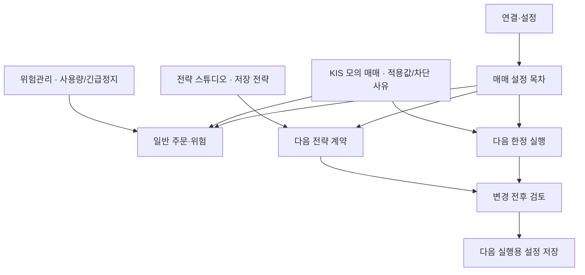

# 매매 제한을 어디서 바꿀 것인가

**권장안은 매매 설정 목차 한 곳과 편집 동선 세 개다.** 목차에는 ‘일반 주문·위험’, ‘다음 한정 실행’, ‘다음 전략 계약’의 현재 요약과 변경 링크만 둔다. 주문 화면에는 해당 주문에 실제로 적용되는 한도와 차단 사유를 남긴다. 한도 변경은 해당 설정으로 바로 이동하고, 계약은 초안 작성·검토·다음 실행에 고정하는 단계를 거친다.

[연구 이슈 #120](https://github.com/krdn/gon-stock03/issues/120). 2026년 11월 19일 기준 설계 제안이다. 일반 앱과 다음 한정 실행·전략 계약까지 편집하는 범위를 선택했고, 진행 중 계약은 고정한다. 제품 반영은 사용자 결정 대기다.

## 현재 화면에서 확인한 문제

실행 중인 4303의 `/paper`, `/risk`, `/strategies`의 KIS 환경, `/settings`를 PC 1440×900과 모바일 390×844에서 열었다. 설정 저장·계좌 조회 버튼·전략 시작은 누르지 않았다. 수량은 5주, 공통 1회 주문 한도는 100만원, 종목별 400만원, 공통 손실 한도는 30만원이었다.

| 관찰한 화면 | PC | 모바일 | 설계에 주는 근거 |
|---|---:|---:|---|
| `/paper` 전체 높이 | 2,513px | 3,424px | 시세·계좌·주문 입력·수량 설정·취소·원장을 한 흐름에 배치한다 |
| 수량 한도 저장 버튼의 상단 위치 | 1,728px | 2,656px | 모바일 첫 화면 높이의 약 3.1배 아래다. 주문 입력 근처에 변경 링크가 필요하다 |
| `/risk` 전체 높이 | 2,022px | 2,865px | 긴급정지·사용량·이력까지 있는 화면이다. 여기에 계약 편집기를 추가하면 운영과 설정이 섞인다 |

측정은 해당 시점 화면의 DOM 좌표다. 데이터·접속 상태에 따라 높이가 바뀐다. 두 너비에서 문서 전체의 가로 넘침은 관측되지 않았다. 제안 동선의 작업 시간과 사용자 선호는 측정하지 않았다. 연결 설정을 다루는 [#113](https://github.com/krdn/gon-stock03/issues/113)과는 ‘매매 설정’ 진입 링크만 공유한다.

## 세 가지 구조 비교

| 구조 | 강점 | 이 앱에서의 비용 | 판단 |
|---|---|---|---|
| 기존 화면마다 편집기 추가 | 주문 도중 바로 수량을 바꿀 수 있다 | 같은 주문을 막는 공통 금액·한정 승인·시간 조건을 찾으려면 여러 화면을 탐색해야 한다 | 주문·차단 사유의 바로가기에 사용 |
| 한 화면의 탭 또는 접이식 구역 | 익숙한 사용자가 비슷한 항목을 빠르게 전환한다 | 다른 탭의 값을 기억해 계약과 공통 한도를 비교해야 한다. 모바일에서 긴 계약 입력과 검토가 한 URL에 얽힌다 | ‘현재/다음’ 비교는 한 표에, 접기는 도움말에 사용 |
| **설정 목차 + 독립 URL + 짧은 계약 절차** | 작업 단위로 이동·공유·뒤로가기가 가능하다. 누가 언제 영향을 받는지 화면별로 표시할 수 있다 | 처음 진입할 때 한 번 더 이동한다 | **채택 제안. 주문 화면에서 해당 편집기로 직접 가는 링크로 보완** |

GOV.UK는 여러 탭의 내용을 비교하거나 순서대로 읽어야 하는 작업에서 탭이 불리하다고 설명한다. W3C WAI는 긴 입력을 논리적 단계로 나누고 페이지 제목과 현재 단계를 제공하도록 권한다. 이를 이 앱에 적용해 단순 수량 변경은 한 번에, 다음 실행·계약만 여러 단계로 편집하도록 제안한다. [탭 사용 기준](https://design-system.service.gov.uk/components/tabs/) · [여러 페이지 양식](https://www.w3.org/WAI/tutorials/forms/multi-page/) · [질문 페이지](https://design-system.service.gov.uk/patterns/question-pages/)

## 제안하는 화면 지도

아래 경로 중 `/settings/trading`으로 시작하는 것은 제안 URL이다. 사이드바에는 상위 진입점 하나만 노출한다.

| 편집 화면 | 배치할 항목과 실제 제약 | 저장의 의미 |
|---|---|---|
| **일반 주문·위험** `/settings/trading/general` | KIS 수동 주문 수량(1~100,000주), DEMO·KIS 공통 주문당 금액·종목별 투자금·일일 손실. 각 행에 적용 환경·단위 표시. 긴급정지/재개는 기존 위험관리에서 즉시 접근 | 새 주문에 적용. 금액과 수량 중 어느 제한에 걸렸는지 결과를 주문 화면에 표시. 저장으로 기존 주문이 취소되거나 실행 중 계약 원본이 수정되지 않는다 |
| **다음 한정 실행** `/settings/trading/once` | ① 날짜·시간·대상 종목·매수 방향·주문유형 ② 승인 수량·주문대금·기존 보유 허용·가격 기준·취소 조건 ③ 변경 전후 검토. 현재 제품의 지정가 재조회 일치, 시세 조회/전송 직전 유효시간 5초, 취소/조회 120초를 각각 표시 | 초안은 자유롭게 수정. 검토 후 다음 전용 원장에 고정. 사용 중·소진된 승인 ID는 읽기 전용. 다른 정책을 허용하려면 서버 지원이 필요하다 |
| **다음 전략 계약** `/settings/trading/strategy` | ① 저장 전략·종목·revision·단기/장기·신호당 수량 ② 시작/종료·주문당 금액·최대 시도·누적 금액·매도 범위 ③ 검토. 전략 원 신호의 유효시간(현행 5초)과 REST 대조·중단/재개 조건을 같은 단계에서 설명 | 저장 전략의 파라미터를 불러와 중복 입력을 줄인다. 새 계약을 고정한 뒤에도 전략은 정지 상태다. 실행 중 계약은 값·사용량·잔여량을 조회하고 ‘다음 계약으로 복사’만 제공한다 |

**현재 값과 설정 가능성도 구분한다.** 다음은 구현 범위를 결정할 때 놓치기 쉬운 제한이다.

- **제품이 정한 정책.** 한정 실행은 현재 매수 1회, 지정가 대상 두 종목, 지정가 승인 상한 20만원이다. 시장가는 삼성전자 1주·승인 상한 30만원이며 API 취소를 허용하지 않는다. 수량 미지정 레거시 승인은 1주다. ‘1회’를 여러 번으로 바꾸려는 사용자는 횟수·누적액을 집행하는 전략 계약으로 안내한다. ‘현재가 일치’는 한정 지정가 모드의 제품 정책이다. 예컨대 ‘거래소 가격 범위 내 지정가’ 옵션은 서버가 그 정책의 주문·취소 조건까지 검증한 뒤 선택 가능하게 한다.
- **시간과 실행 상태.** 거래소의 당일 세션과 사용자가 선택할 실행 구간을 나란히 보여주고 그 교집합을 표시한다. 제품의 09:00~15:30 상한, 시세 신선도, 특별 개장일, 단절 후 재대조는 서로 다른 조건이다. 시세 수신·예약·실제 전송이 참조하는 시간 기준을 일치시켜야 한다. 승인 1회 소진·자동 정지, 미체결 존재 시 차단, REST 전체 대조 및 불명 복구(근거 유효기간 5분)도 차단 화면에 출처와 함께 표시한다.
- **증권사·원장의 제약.** 거래정지, 당일 상·하한가/호가 단위, 현금·미수 없는 매수가능량, 매도가능량, 기존 미체결과 보유, 중복 요청 방지 및 계좌 식별은 상태와 조치 경로를 제공한다. 취소가능수량 선행조회는 모의 미지원이며 한정 취소 검증은 일반 취소 권한으로 확대되지 않는다. 계좌 지문·원장 경로·요청 ID는 서버가 바인딩한다. [KIS 취소 규격 근거](kis-order-recovery-2026-11.md)
- **운영 수치.** KIS 클라이언트의 요청 간격 1,100ms·대기열/타임아웃, 실시간 단절 감시·재연결 횟수, 주문 보관 상한(KIS 1,000건·DEMO 10,000건)은 진단 상세에 표시한다. 이 숫자는 모두 증권사 규정인 것이 아니며 계좌별 주문 한도와도 용도가 다르다. #107 CLI는 원장을 분리하고 같은 증권사 모의계좌를 사용한다. 일반 앱 설정의 적용 대상을 화면에 명시한다.

코드 대조용 기준은 [입력과 위험 한도](../../shared/contracts.ts), [일반·한정 주문 및 취소](../../server/paper.ts), [실시간 시세·세션](../../server/realtime.ts), [전략 계약 스키마](../../server/strategy-contract.ts), [승인·계약 원장](../../server/store.ts), [DEMO 위험 검사](../../server/engine.ts), [KIS 통신](../../server/kis.ts), [전용 실행기](../../scripts/vts-runner.ts)다.

## 세 가지 대표 동선

1. **수동 수량 5→8주.** 주문 입력 옆 ‘현재 한도 5주 · 변경’ → 일반 주문·위험의 수량 필드로 직접 이동 → 8주 저장 → 원래 종목과 입력을 유지해 주문 화면으로 복귀. 별도 승인이 3주라면 ‘수동 8주 / 승인 3주 / 이 주문 최대 3주’를 표시한다. 공통 금액·보유 조건은 이후에도 검사한다.
2. **하한가 주문이 차단된 이유 확인.** 11월 19일 사례를 쓰면 ‘주문 136,300원 / 재조회 190,700원 / 한정 실행의 현재가 일치 조건’ → ‘다음 한정 실행 설정’ → 현재 지원하는 가격 정책과 취소 가능 여부 확인. 수량 설정으로 잘못 유도하지 않는다. 새 정책이 지원될 때만 선택·검토·저장한다. [실제 차단 기록](../tasks/116-paper-cancel.md#주문당-수량-설정--11월-19일)
3. **실행 중 전략을 유지하며 다음 계약 준비.** 전략 스튜디오 → 해당 전략의 ‘다음 계약 준비’ → 기존 값 복사 → 기간·횟수·누적액 수정 → 검토 화면에서 ‘현재 계약’과 ‘다음 계약’을 같은 행에서 비교 → ‘다음 계약 저장’. 시작은 기존 전략 스튜디오의 별도 동작으로 남는다.

모바일은 목차를 세로 목록으로 제공한다. 계약 단계마다 ‘2/3 한도’처럼 제목을 표시하고, 검토의 ‘수정’은 해당 단계로 돌아간다. 뒤로가기와 새로고침에서 초안이 유지돼야 한다. 저장 실패 시 입력과 오류 필드로의 초점을 유지하고, 정상 저장 시 적용 시점을 알려준다. [검토 후 개별 항목 수정 패턴](https://design-system.service.gov.uk/patterns/check-answers/)

## 구현 결정 후 검증할 것

- **정보 구조** — 주문 차단 사유에서 정확한 필드로 바로 가는지, 사용자가 모바일에서 5→8주를 변경하고 주문 화면으로 복귀할 수 있는지 관찰한다. 목차는 링크·요약만, 각 값의 편집기는 한 곳에 둔다.
- **값의 집행** — 일반 설정은 기존 서버 저장 경로와 전송 직전 검사를 재사용한다. 다음 실행 초안은 진행 중 계약과 다른 저장소 또는 버전으로 보관하고, 새 원장 생성 시 서버가 지원 조합·계좌·revision·총액을 재검증한다. 오늘은 환경변수로 실행 시점에 읽는 구조라 UI 초안에서 다음 서버 실행까지 잇는 작업이 필요하다. [서버 시작 경로](../../server/index.ts)
- **구현 결정 사항** — 우선 기본 설정과 다음 두 계약의 편집·검토 동선을 도입할지, 가격 기준·종목·매도 범위·시장가 규격·유효시간 중 어떤 서버 정책까지 확장할지 결정한다. 서버 미지원 항목은 이유와 함께 표시한다. 테스트에서는 설정 저장 시 브로커 POST 0회, 변경 후 재시작·기존 계약 불변·소진 원장 재사용 차단을 확인한다.
